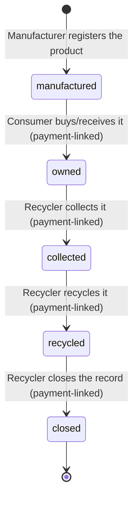
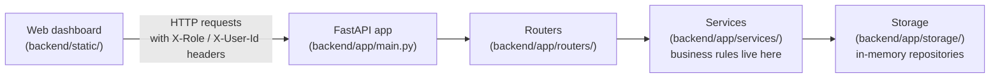

# Plastic DPP Greenfield Project

A capstone project that builds a **Digital Product Passport (DPP)** system for plastic products — think of it as a digital ID card for every plastic item that follows it from the factory all the way to recycling, so nobody can fake "yes, it got recycled" without proof.

This README explains the idea in plain language, how the pieces fit together, and exactly what commands to run to see it working.

---

## 1. The idea, explained simply

### The problem this solves

Imagine a plastic bottle. Today, once it leaves the factory, nobody can reliably answer:
- Who owns it right now?
- Did it actually get collected for recycling, or did someone just say it did?
- Did it actually get recycled, or is that claim just written on a piece of paper somewhere?

A QR code sticker alone doesn't fix this — anyone can print a QR code and scan it without anything real happening. Scanning is not proof.

### The fix: tie every real change to a real transaction

This project's core idea is:

> **A QR code is only used to *look up* a product's identity and current status — never to *change* it.** To actually change a product's stage in its life (like "it got collected" or "it got recycled"), someone has to create a **payment-linked transaction** first, and the system checks that transaction is real and unused before it accepts the change.

Think of it like a receipt. You can't prove you paid for your groceries just by showing someone the receipt printer — you need an actual, validated receipt tied to a real transaction. Same idea here: a lifecycle change is only accepted if it comes with a valid "receipt" (a transaction record).

For this MVP (**M**inimum **V**iable **P**roduct — the smallest working version that proves the idea), we **simulate** the payment step with an internal transaction ledger instead of connecting to a real bank or blockchain. The system is *designed* so a real payment gateway or blockchain can be plugged in later without rebuilding everything — but for now, creating a transaction just instantly marks it "confirmed," so we can test the whole flow without needing real money or a real blockchain network.

### Key terms (glossary)

| Term | What it means here |
|---|---|
| **DPP (Digital Product Passport)** | A record in the system representing one physical plastic product. It has a unique ID (like `DPP-000001`), what it's made of, when it was made, who made it, and its current life stage. |
| **QR code** | A unique code bound to one DPP, used only to *look up* that product (read-only). In real life this would be printed on the product. In this MVP, it's just a text string like `qr://dpp-000001`. |
| **Lifecycle state** | Which stage of its life the product is in. See the state diagram below. |
| **Lifecycle event** | A permanent, unchangeable log entry recording one state change — who did it, when, and which transaction proved it was legitimate. |
| **Transaction (payment-linked)** | A record that stands in for "a real payment or exchange happened." Each transaction can only be used once, so nobody can reuse the same "receipt" to fake two different lifecycle changes. |
| **Role** | Which type of stakeholder is making a request: Manufacturer, Consumer, Recycler, or Regulator (see below). Each role is only allowed to do certain things. |

### The lifecycle states

Every product moves through a fixed, one-way sequence of states. It can only move forward, never backward, and once it's `closed` it can never change again:



If someone tries to skip a step (e.g. jump straight from `manufactured` to `recycled`), or tries to change a `closed` product, the system rejects it.

### The four roles

| Role | What they can do |
|---|---|
| **Manufacturer** | Register new products (create a DPP + QR code). Cannot change lifecycle state themselves. |
| **Consumer** | Look up products; create a transaction and use it to move a product from `manufactured` → `owned` (taking ownership). |
| **Recycler** | Look up products; create transactions and move a product through `owned` → `collected` → `recycled` → `closed`. |
| **Regulator** | Read-only — can view every product's full history and a summary compliance report, but can never create, change, or delete anything. |

---

## 2. How the system is put together (architecture)



- **`backend/static/`** — the web dashboard (plain HTML/CSS/JavaScript, no build step). This is what you see in the browser.
- **`backend/app/main.py`** — starts the FastAPI web server, wires everything together, and turns internal errors into proper HTTP responses (404 Not Found, 403 Forbidden, 409 Conflict, 400 Bad Request).
- **`backend/app/routers/`** — defines the actual URL endpoints (e.g. `POST /products`). Each router reads the request, calls a service, and returns the result.
- **`backend/app/services/`** — this is where the actual rules live: "only a manufacturer can register a product," "a transaction can only be used once," "you can't skip lifecycle states." This is the most important folder to read if you want to understand *how* the system enforces its rules.
- **`backend/app/storage/`** — a simple in-memory "database" (Python dictionaries). Data disappears when the server restarts — that's fine for a capstone demo, and it's built so a real database can be swapped in later without changing the rules in `services/`.
- **`backend/app/models/`** — the shape of the data (what fields a product has, what states are valid, etc.), written using Pydantic (a Python library that validates data automatically).
- **`backend/tests/`** — automated tests, split into `unit/` (testing one small piece of logic), `contract/` (testing one API endpoint's request/response shape), and `integration/` (testing a full realistic flow end-to-end).

### How "who is making this request" works (mock authentication)

Real login systems (username/password, OAuth, etc.) are out of scope for this MVP. Instead, every request must include two HTTP headers:

- `X-Role` — one of `manufacturer`, `consumer`, `recycler`, `regulator`
- `X-User-Id` — any text identifying the caller, e.g. `mfg-1`

The server reads these headers (see `backend/app/routers/dependencies.py`) and uses them to decide what you're allowed to do. The web dashboard has a Role dropdown and a User ID box at the top that set these headers automatically for you — you don't need to type raw HTTP headers yourself.

---

## 3. How to run it

### Prerequisites

- Python 3.11+ installed (this was built and tested with Python 3.13)
- A terminal (PowerShell on Windows)

### Step-by-step commands

```powershell
# 1. Go into the backend folder — this matters, the app won't start from anywhere else
cd "plastic-dpp-greenfield/backend"

# 2. (Recommended, one-time) create an isolated Python environment so these
#    dependencies don't clash with anything else on your machine
python -m venv .venv
.venv\Scripts\activate

# 3. Install the required packages (FastAPI, Uvicorn, Pydantic, pytest, httpx)
pip install -r requirements.txt

# 4. Start the web server
python -m uvicorn app.main:app --reload
```

What each part of that last command means:
- `python -m uvicorn` — run the `uvicorn` package (the web server that actually listens for HTTP requests and runs your FastAPI code)
- `app.main:app` — "go into the `app` package, open `main.py`, and use the object named `app`" (that's the FastAPI application object)
- `--reload` — automatically restart the server whenever you save a code change, so you don't have to stop/start it manually while developing

You should see output like:
```
INFO:     Uvicorn running on http://127.0.0.1:8000 (Press CTRL+C to quit)
INFO:     Application startup complete.
```

Leave this terminal running — it *is* the server. Closing it (or pressing `Ctrl+C`) stops the API.

---

## 4. Where to see results

Once the server is running, open a browser to:

| URL | What it is |
|---|---|
| **http://127.0.0.1:8000/ui/** | The web dashboard — the easiest way to use and see everything. Visiting the bare root `http://127.0.0.1:8000/` also redirects here automatically. |
| **http://127.0.0.1:8000/docs** | Auto-generated interactive API documentation (Swagger UI) — lets you try every endpoint directly, see exact request/response shapes, without needing the dashboard or `curl`. |
| **http://127.0.0.1:8000/health** | A simple "is the server alive?" check — returns `{"status": "ok", ...}` as plain JSON. |

### Using the dashboard (http://127.0.0.1:8000/ui/)

The dashboard is one page with six numbered sections, meant to be used roughly top to bottom:

1. **Register a product** — pick role `manufacturer` at the top, fill in the form, click Register. You'll get back a new `dpp_id` and `qr_code_ref`.
2. **Products** — click "Refresh list" to see every registered product and its current state; or type a DPP ID / QR code to look one up directly. This never changes anything (it's read-only, by design — see the theory section above).
3. **Create a transaction** — switch role to `consumer` (or `recycler`), optionally enter a value, click "Create transaction". You'll get a `transaction_id` — copy it, you'll need it in the next step.
4. **Submit a lifecycle transition** — paste the DPP ID, choose the target state, paste the transaction ID from step 3, and submit. If everything is valid, the product's state moves forward one step.
5. **Lifecycle history** — paste a DPP ID to see every event ever recorded for it, in order, with who did it and which transaction backed it.
6. **Regulator compliance report** — switch role to `regulator`, click "Fetch report" to see a count of products in each lifecycle state.

If something is rejected, the dark output box under that section will show the error message and the reason (e.g. "Only manufacturers may register products").

---

## 5. What's actually happening when you click a button (request flow)

Here's the full journey of a single "submit a lifecycle transition" click, as a concrete example:

1. You click **Submit transition** in the dashboard.
2. The browser's JavaScript (`backend/static/app.js`) sends an HTTP `POST` request to `/products/{dpp_id}/lifecycle-events`, with your chosen role/user id as headers and the target state + transaction id as the request body.
3. FastAPI routes this to the function in `backend/app/routers/lifecycle.py`.
4. That function calls `LifecycleService.transition(...)` in `backend/app/services/lifecycle_service.py`, which:
   - Looks up the product (fails with 404 if it doesn't exist)
   - Checks your role is allowed to make this specific transition (fails with 403 if not)
   - Checks the new state is actually reachable from the current state (fails with 409 if not — e.g. you can't skip straight to `recycled`)
   - Checks the transaction id exists, is confirmed, and hasn't already been used for something else (fails with 400 if not)
5. If all checks pass, it creates a permanent `LifecycleEvent` record and updates the product's current state.
6. The result flows back up through the router, out as an HTTP response, and the dashboard displays it in the output box.

This same pattern (router → service → storage, with the service doing all the rule-checking) is used for every feature in the app.

---

## 6. Running the automated tests

The project has 38 automated tests that check all of this behavior automatically (no browser needed):

```powershell
cd "plastic-dpp-greenfield/backend"
python -m pytest -q
```

You should see something like `38 passed` at the end. These tests live in `backend/tests/` and are organized the same way as the rules they test:
- `tests/unit/` — tests one function or rule in isolation (e.g. "is `closed → recycled` correctly rejected?")
- `tests/contract/` — tests one API endpoint's behavior directly (e.g. "does `POST /products` return 403 for a non-manufacturer?")
- `tests/integration/` — tests a full realistic flow end-to-end (e.g. register → look up → transact → transition → view history)

---

## 7. Project documentation (the "why" behind every decision)

This repo follows a **Spec Kit** workflow — a structured way of writing down *what* to build and *why*, before writing code. Everything for this feature lives in [specs/001-plastic-dpp-passport/](specs/001-plastic-dpp-passport/):

| File | What's in it |
|---|---|
| [spec.md](specs/001-plastic-dpp-passport/spec.md) | The full product spec: vision, problem statement, goals, roles, functional/non-functional requirements, MVP scope, assumptions, future ideas |
| [plan.md](specs/001-plastic-dpp-passport/plan.md) | The technical plan: tech stack, folder structure, and reasoning |
| [research.md](specs/001-plastic-dpp-passport/research.md) | The specific technical decisions (e.g. why an in-memory store, how the simulated transaction ledger works) and why alternatives were rejected |
| [data-model.md](specs/001-plastic-dpp-passport/data-model.md) | Every entity (DPP, Transaction, etc.) and its fields |
| [contracts/](specs/001-plastic-dpp-passport/contracts/) | The exact request/response shape of every API endpoint |
| [quickstart.md](specs/001-plastic-dpp-passport/quickstart.md) | A copy-pasteable `curl`-based walkthrough of the whole flow |
| [tasks.md](specs/001-plastic-dpp-passport/tasks.md) | The full implementation checklist (all 45 tasks are marked done) |

Older, simpler planning notes from before this workflow was fully set up also still exist in [docs/spec.md](docs/spec.md), [docs/plan.md](docs/plan.md), and [docs/tasks.md](docs/tasks.md) — the `specs/001-plastic-dpp-passport/` versions above are the current, detailed source of truth.

---

## 8. Troubleshooting

- **`{"detail":"Not Found"}` when visiting the site** — you're probably hitting a leftover/stale server process from an old run that doesn't have the current code. Stop whatever is using port 8000 and start a fresh `uvicorn` process from `backend/` as shown in section 3.
- **`ModuleNotFoundError: No module named 'app'`** — you ran the `uvicorn` command from the wrong folder. You must run it from inside `backend/`, not from the repository root.
- **`[Errno 10048] ... only one usage of each socket address ...`** — something is already listening on port 8000. Either stop that process, or run on a different port: `python -m uvicorn app.main:app --reload --port 8001` (then use that port number in all the URLs above).
- **Dashboard loads but every action fails with a 403** — check the Role dropdown at the top of the dashboard; some actions only work for specific roles (e.g. only `manufacturer` can register a product).

